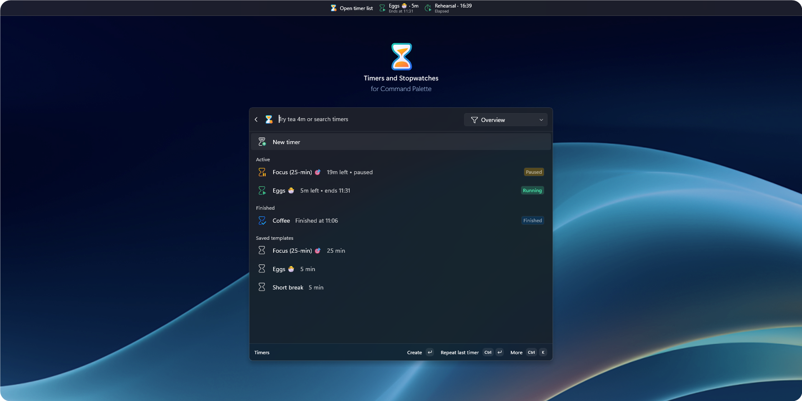
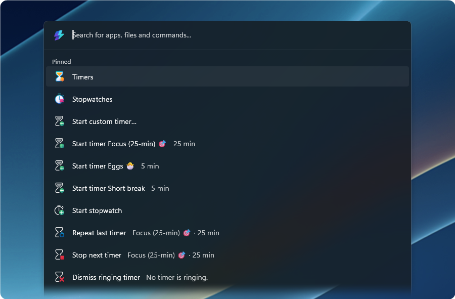
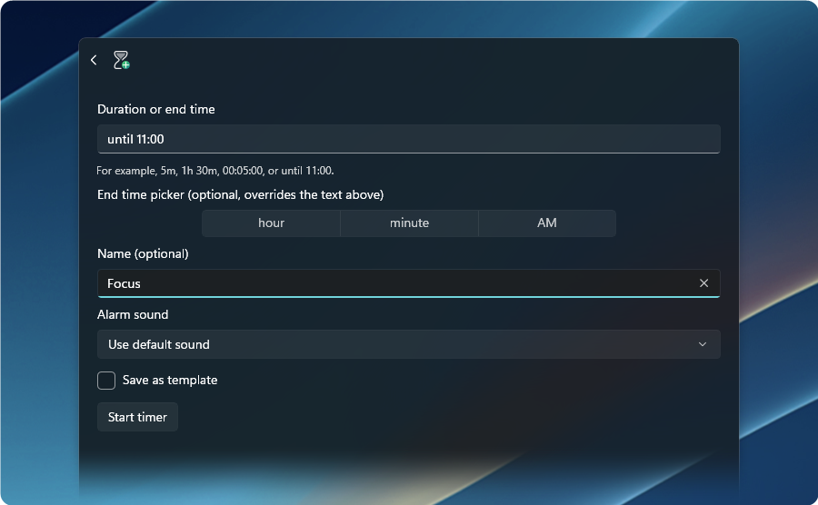
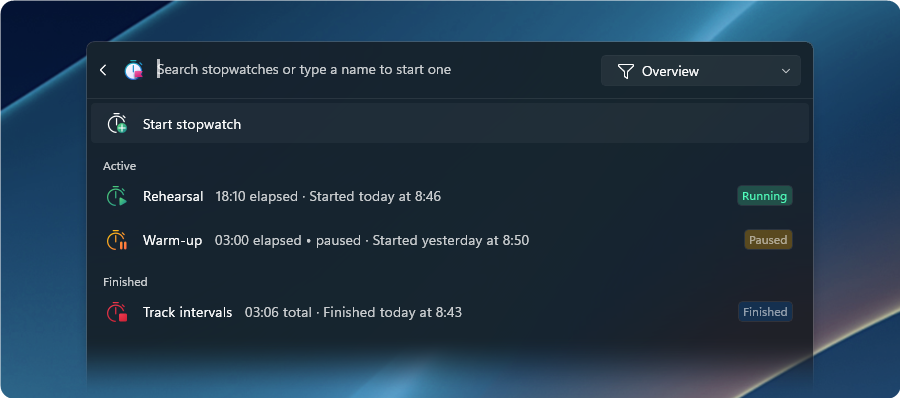
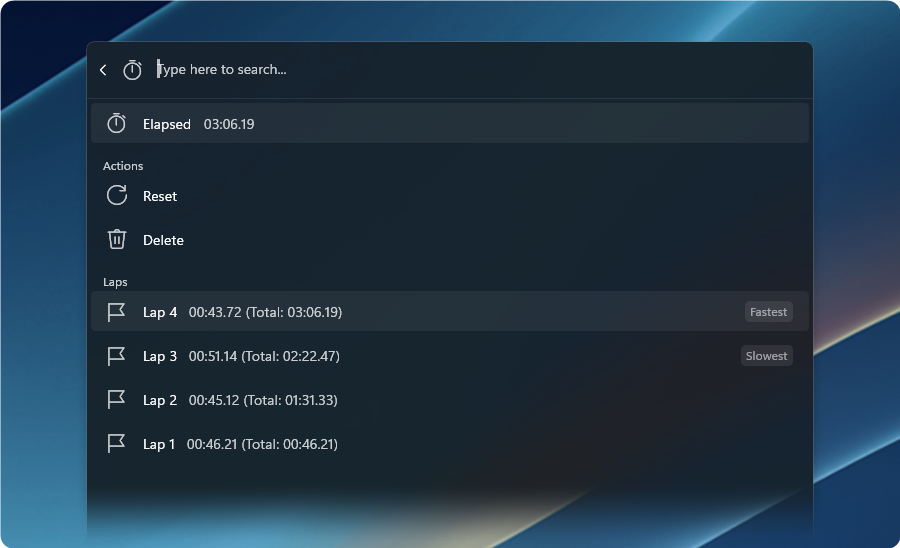

<div align="center">


<h1 align="center"><span style="font-weight: bold">Timers</span> <br /><span style="font-weight: 200">for Command Palette</span></h1>

<p><a href="https://timers.jiripolasek.com/">Timers website</a></p>

</div>

Run named countdowns and stopwatches side by side in [PowerToys Command Palette](https://learn.microsoft.com/en-us/windows/powertoys/command-palette/overview) and its Dock. Start a four-minute tea timer while your focus timer runs, and pause either one independently.

<p align="center">
  <a href="art/screenshots/timers-and-dock.png">
    
  </a>
</p>

## Features

- **Countdown timers** — Enter a duration or a local finish time. Preview when a timer will end or how long it will run before you start it.
- **Reusable timers** — Save frequently used countdowns as templates, pin them to the Dock, or repeat your most recent timer.
- **Stopwatches and laps** — Time several activities independently. Each lap shows its duration and total elapsed time, with the fastest and slowest laps marked when their times differ.
- **Timer alerts** — Choose an alarm sound and volume or a silent notification. Snooze a finished timer for five minutes or restart the original countdown.
- **Dock integration** — See every running or paused item, follow the most recent one, or pin an individual timer or stopwatch.
- **Personalization** — Open settings from the **Timers** or **Stopwatches** actions to choose when countdowns show seconds, enable animated icons, and set confirmation prompts for individual deletions or clearing a list.

Timers, templates, stopwatches, and recorded laps are saved across restarts.

## Using timers and stopwatches

Open Command Palette (`Win+Alt+Space` by default), type `Focus 25m` or `Start timer Focus 25m`, and select the matching result. Press `Enter` to start the countdown and close the palette. You can enter the same queries on the **Timers** page. These examples use a 12-hour clock.

Home also offers **Start custom timer…**, **Start stopwatch**, **Dismiss ringing timer**, and a **Start timer ‹name›** command for each saved template. **Repeat last timer** shows the timer it will restart. **Stop next timer** shows the running timer closest to finishing. Press `Enter` on the command to stop that timer.

To start a named stopwatch from Home, type `stopwatch Rehearsal` or `start stopwatch Rehearsal` and choose **Start stopwatch "Rehearsal"**.

<p align="center">
  <a href="art/screenshots/home-commands.png">
    
  </a>
</p>

| Type at 3:05 PM | Result preview |
| --- | --- |
| `Tea 4m` | Start timer · Ends at 3:09 PM if started at 3:05 PM |
| `Focus 1h 30m` | Start timer · Ends at 4:35 PM if started at 3:05 PM |
| `until 15:30` | Start timer until 3:30 PM · 25m if started at 3:05 PM |

Clock times refer to the next occurrence in your local time zone. Use a keyword for compact 24-hour input, such as `until 2300` for 23:00 or `at 930` for 09:30. A bare number is a duration in minutes. The preview follows your Windows clock format. To reuse a duration, choose **New timer**, enter the duration, and turn on **Save as template** before starting it.

Choose **Alarm sound** when creating a timer, editing a template, or opening a timer’s details. **Use default sound** follows the extension setting. **Silent (notification only)** still shows the timer notification. Templates and repeated timers keep their sound choice.

<details>
<summary>See the New timer form</summary>
<br>

<p align="center">
  <a href="art/screenshots/new-timer.png">
    
  </a>
</p>

</details>

New profiles start with 10-minute, 30-minute, and 1-hour templates. You can edit or delete them like any other template. If you delete them all, your template list stays empty.

On the **Timers** page, **Start 5 min** starts a countdown when the list is new. Once something has run, use **Start again** on the finished timer or the named **Repeat** shortcut. Timers and Stopwatches keep the latest finish visible. Choose **Show older results** to expand the finished section in place. On Timers, **Clear finished timers…** removes finished and stopped countdowns from the overview after confirmation.

Choose **Add 1 min** or **Add 5 min** from a timer row's **More** menu, its details, or its Dock menu. A paused timer stays paused, and a finished timer runs for the added time. If you extend or snooze a 35-minute timer, **Restart** starts the full 35 minutes again. **Repeat last timer** restarts the most recently started timer at its original duration.

To time a rehearsal, open **Stopwatches**, type `Rehearsal`, and choose **Start stopwatch "Rehearsal"**. Select the running stopwatch and press `Ctrl+L` to record a lap. The first lap reveals the split times. Choose **Finish** to keep the elapsed time and laps, then choose **Copy elapsed time** from the result. In either list, search by name, filter by state, or press `Ctrl+P` to pause or resume the selected item.

<details>
<summary>See the stopwatch list and lap details</summary>
<br>

<p align="center">
  <a href="art/screenshots/stopwatches.png">
    
  </a>
</p>

<p align="center">
  <a href="art/screenshots/stopwatch-laps.png">
    
  </a>
</p>

</details>

## Using the Dock

Enable the Dock in Command Palette settings. Right-click its background, choose **Edit Dock**, select **+** to add a band, and choose **Save**. [Command Palette Dock guide](https://learn.microsoft.com/en-us/windows/powertoys/command-palette/dock#pin-from-dock-edit-mode)

<p align="center">
  <a href="art/screenshots/dock-detail.png">
    
  </a>
</p>


- **Active timers** and **Active stopwatches** show a button for every running or paused item. The title includes the name and time, even in Compact mode. Pin an individual timer or stopwatch to follow just that item.
- **Latest active timer** and **Latest active stopwatch** each show the time for the newest running or paused item.
- **Open timer list** and **Open stopwatch list** open the corresponding page in Command Palette.
- To pin a template, right-click it under **Saved templates** in **Timers** and choose **Pin to Dock**. Each click starts a new countdown with the saved name and duration. [First Dock shortcut](CHANGELOG.md#first-dock-shortcut)

When there are no active items, the bands that show live times offer **New timer** or **Start stopwatch**. Right-click a paused item to **Resume**. The menu on a timer or **Open timer list** lets you open **New timer** or start a saved template. On a stopwatch or **Open stopwatch list**, choose **Start new stopwatch**.

## Installation

> Timers requires [Microsoft PowerToys](https://apps.microsoft.com/detail/xp89dcgq3k6vld) with Command Palette enabled.

The first public release will be available through the Microsoft Store and WinGet. To try Timers before then, [build it from source](#development).

### Microsoft Store installation (recommended)

<a href="https://apps.microsoft.com/detail/9P32P0T1C3VX"></a>

### Command Palette

In Command Palette, type `WinGet` and open the package search. Find **Timers for Command Palette** and choose **Install**.

### WinGet

Run this command in a terminal.

```pwsh
winget install --id 9P32P0T1C3VX --source msstore
```

### Manual installation

Download the signed MSIX for your PC (`x64` or `ARM64`) and open it to install. [GitHub releases](https://github.com/jiripolasek/TimersExtension/releases)

## Development

See the [development guide](docs/dev/README.md) for setup, builds, testing, and local deployment.

## Licence

[Apache License 2.0](LICENSE.txt)

## Author

[Jiří Polášek](https://jiripolasek.com)
